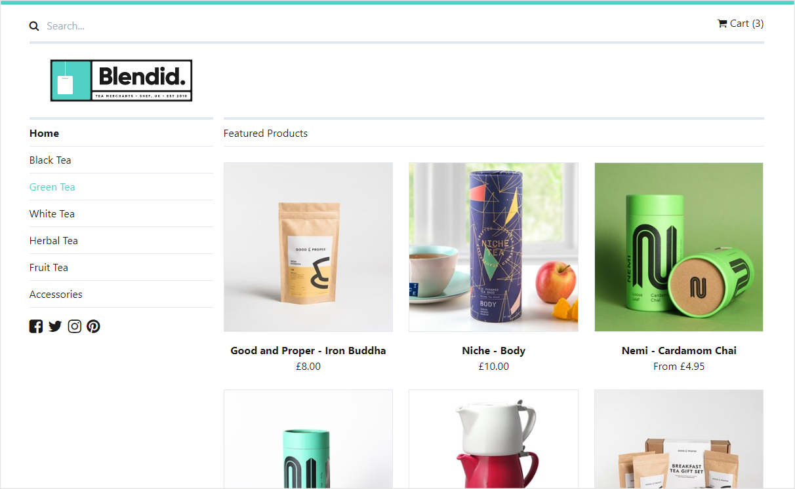

# Umbraco Commerce Demo Store

Welcome to the Umbraco Commerce Demo Store, an example webstore setup using Umbraco Commerce in [Umbraco](https://umbraco.com).



> This branch is the demo for Umbraco Commerce 17. For the latest version, see the [`main`](https://github.com/umbraco/Umbraco.Commerce.DemoStore) branch.
 
## About this Demo

In this demo you will find a fully configured basic webstore using Umbraco Commerce on Umbraco. The store is based around a fictitious tea retailer called Blendid which lists a variety of teas from multiple companies and also displays them in categories. Where products have multiple pricing options, variant nodes are used to provide buying options for those particular product choices.

The site also showcases a basic shopping cart setup with cart management features via the Umbraco Commerce API as well as a checkout flow following all the main steps required for a Umbraco Commerce order entity. On checkout, there will also be examples of order confirmation emails that will be sent (**TIP** Use something like [Papercut](https://github.com/ChangemakerStudios/Papercut) to capture these without them needing to be actually sent).

In the back office you'll find a suggested content structure for a working Umbraco Commerce webstore and you'll also be able to browse the store setup and example orders in the settings and commerce sections respectively.

## System Requirements

To get started with the Umbraco Commerce demo store you will need:

* .NET SDK 10.0.100 or newer.
* Optionally, an IDE such as Visual Studio, Visual Studio Code or JetBrains Rider. You can also run the site from the command line.

This demo store supports two database editions. By default it uses a `sqlite` database, but it also comes with a `.\db\UmbracoCommerceDemoStore_v17.7.2.bacpac` file which is exported from a SQL Server 2022.

`sqlite` edition is fine if you just want to look around the store, but if you want to mess around, SQL Server edition is less likely to lock up when things go wrong.

## Getting Started

Clone or download this repository locally (it includes all the files you will need including a fully configured SQLite database)

````
git clone -b support/17.x https://github.com/umbraco/Umbraco.Commerce.DemoStore.git
````

Once you have all the files downloaded you can open the `Umbraco.Commerce.DemoStore.sln` solution file in the root of the repository in Visual Studio. Make sure the `Umbraco.Commerce.DemoStore.Web` project is the startup project by right clicking the project in the Solution Explorer and choosing `Set as StartUp Project`, and then press `Ctrl + F5` to launch the site.

To run it from the command line instead:

````
dotnet run --project src/Umbraco.Commerce.DemoStore.Web
````

The site then runs at `https://localhost:44322`.

*Optional* - Import `.\db\UmbracoCommerceDemoStore_v17.7.2.bacpac` using Data-tier application (or `sqlpackage /a:Import`) and update `ConnectionStrings` in `appsettings.json` to be similar like this:
```json
  "ConnectionStrings": {
    "umbracoDbDSN": "Server=.;Database=UmbracoCommerceDemoStore_v17.7.2;User Id={your_db_username};Password={your_db_password};TrustServerCertificate=true;",
    "umbracoDbDSN_ProviderName": "Microsoft.Data.SqlClient"
  }
```

If the database is older than the packages the site uses, it upgrades the database automatically the first time it runs.

To log in to the back office, use these credentials:

* **Email** `admin@example.com`
* **Password** `password1234`


## License

Copyright © 2023 Umbraco

This demo store is [licensed under MIT](LICENSE.md). The core Umbraco Commerce product is licensed under Umbracos commercial license.

